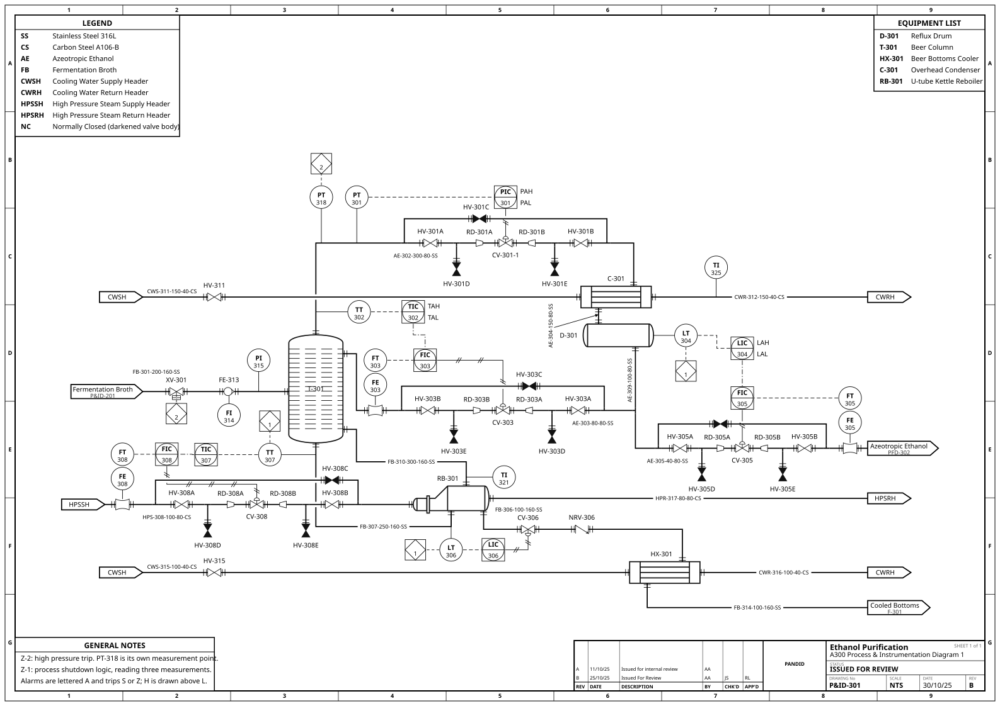

# pandid

Draw process flow diagrams (PFDs), piping and instrumentation diagrams (P&IDs)
and block flow diagrams (BFDs) from Python. Describe the equipment and how it
connects; pandid places the units and routes the lines.

[](https://github.com/Alpha9463/pandid/blob/main/docs/gallery/README.md)

## Install

Requires Python 3.11 or later.

```bash
pip install pandid
pip install 'pandid[pdf]'   # optional PDF and PNG output
pip install 'pandid[yaml]'  # optional YAML input
```

## Quick start

```python
from pandid import Feed, Flowsheet, Heater, Product, Separator

fs = Flowsheet("Flash Separation")
feed = fs.add(Feed("Crude"))
heater = fs.add(Heater("E-101"))
drum = fs.add(Separator("V-101"))
gas = fs.add(Product("Off-Gas"))
liquid = fs.add(Product("Condensate"))

fs.connect(feed.outlet, heater.inlet)
fs.connect(heater.outlet, drum.feed)
fs.connect(drum.vapor, gas.inlet)
fs.connect(drum.liquid, liquid.inlet)

fs.render("flash.svg")
```

Render to SVG, draw.io, PDF or PNG. Pin equipment or route a line by hand when
a drawing needs it.

## Features

- Automatic layout and routing, with manual overrides.
- Equipment symbols, instruments, control loops and line numbers.
- Title blocks, borders, equipment lists and stream tables.
- Python, JSON or YAML input, and a `pandid` command to draw and check a sheet.
- No runtime dependencies in the core package.

pandid draws diagrams; it does not calculate mass or energy balances. It
follows process-drawing standards but is not certified against them.

## Learn more

- [Example gallery](https://github.com/Alpha9463/pandid/blob/main/docs/gallery/README.md)
- [API reference](https://github.com/Alpha9463/pandid/blob/main/docs/api.md)
- [Changelog](https://github.com/Alpha9463/pandid/blob/main/CHANGELOG.md)
- [Contributing](https://github.com/Alpha9463/pandid/blob/main/CONTRIBUTING.md)

## Licence

pandid is source-available for noncommercial use under the
[PolyForm Strict License 1.0.0](https://polyformproject.org/licenses/strict/1.0.0).
The licence does not grant permission to distribute or modify the software.
For a separate licence, contact `alexandersonxii+pandid@gmail.com`.
Vendored equipment symbols have separate terms; see
[LICENSE](https://github.com/Alpha9463/pandid/blob/main/LICENSE),
[LICENSE-APACHE](https://github.com/Alpha9463/pandid/blob/main/LICENSE-APACHE)
and [NOTICE](https://github.com/Alpha9463/pandid/blob/main/NOTICE).
