# Example gallery

These diagrams are generated from the scripts in [`examples/`](../../examples).
Each entry links to its Python source and vector SVG. Rebuild the gallery with
`python scripts/gallery.py`.

## 01 · Manual layout, with the coordinate overlay

Corner and nozzle pins, manual waypoints, and the debug coordinate overlay.

[`01_manual_layout.py`](../../examples/01_manual_layout.py) · [SVG](01_manual_layout.svg)

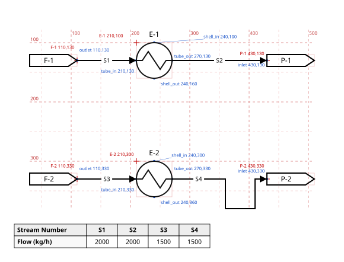

## 02 · Distillation train

Distillation train with a zone border, title block, equipment list, stream table, and recycle.

[`02_distillation_train.py`](../../examples/02_distillation_train.py) · [SVG](02_distillation_train.svg) · [draw.io](../../drawio-samples/02_distillation_train.drawio)

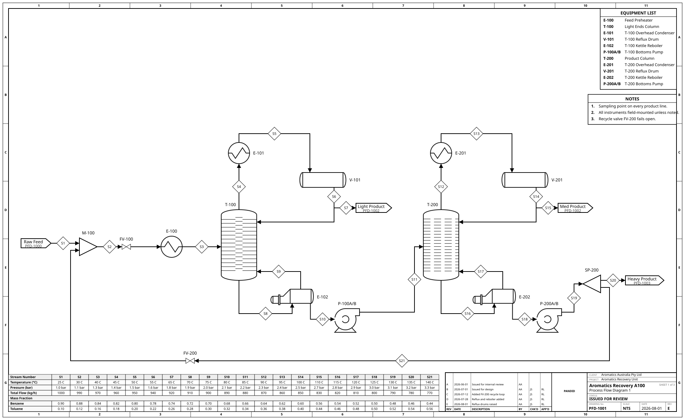

## 03 · Control loop

Two control loops with signal lines, alarms, an interlock, and a relief valve.

[`03_control_loop.py`](../../examples/03_control_loop.py) · [SVG](03_control_loop.svg)

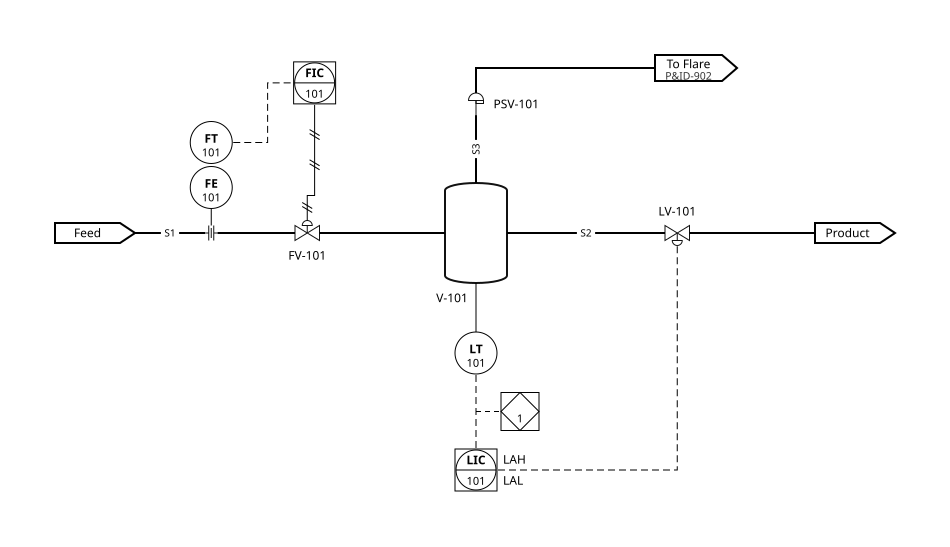

## 04 · Reactor recycle

Automatically placed reactor train with a purge and recycle branch.

[`04_reactor_recycle.py`](../../examples/04_reactor_recycle.py) · [SVG](04_reactor_recycle.svg)

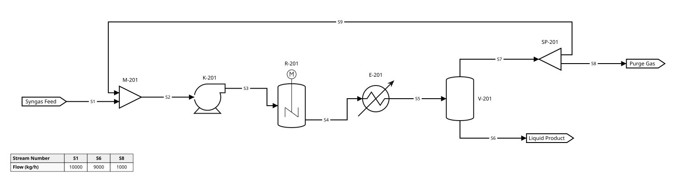

## 05 · Column reflux and reboiler

Column reflux and kettle-reboiler returns and two side draws, with nozzle-based placement.

[`05_column_reflux.py`](../../examples/05_column_reflux.py) · [SVG](05_column_reflux.svg)

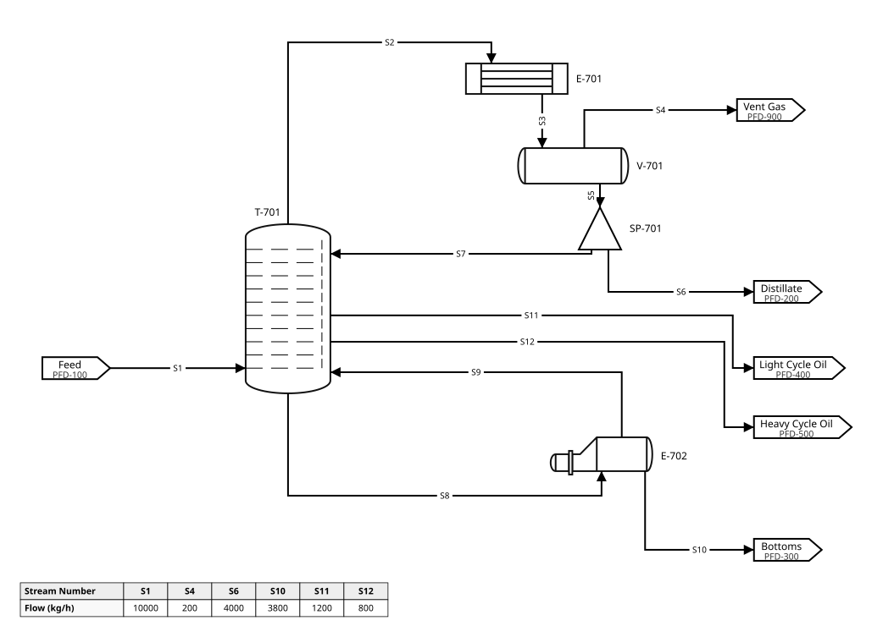

## 06 · Metering skid

Metering skid with inline fittings, an actuated valve, and vessel level control.

[`06_metering_skid.py`](../../examples/06_metering_skid.py) · [SVG](06_metering_skid.svg)

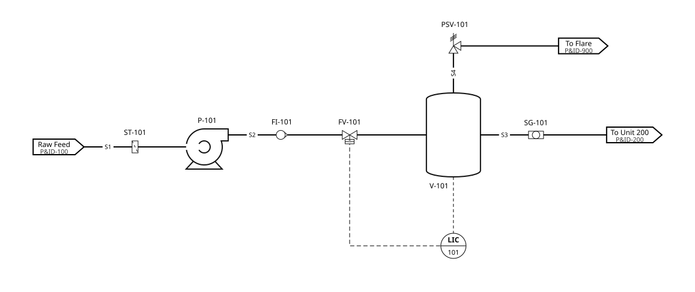

## 07 · Built from data

Boiler-feedwater diagram built from a plain mapping with `Flowsheet.from_dict()`.

[`07_from_data.py`](../../examples/07_from_data.py) · [SVG](07_from_data.svg)

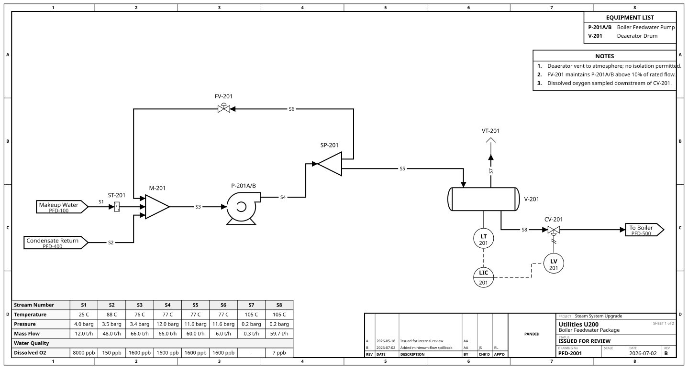

## 08 · Line numbers

P&ID line numbers carried through fittings and broken at specified equipment.

[`08_line_numbers.py`](../../examples/08_line_numbers.py) · [SVG](08_line_numbers.svg)

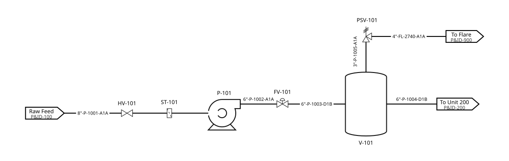

## 09 · Ethanol purification PFD

A3 ethanol PFD with off-page connectors, a utilities summary, and a stream table.

[`09_ethanol_pfd.py`](../../examples/09_ethanol_pfd.py) · [SVG](09_ethanol_pfd.svg)

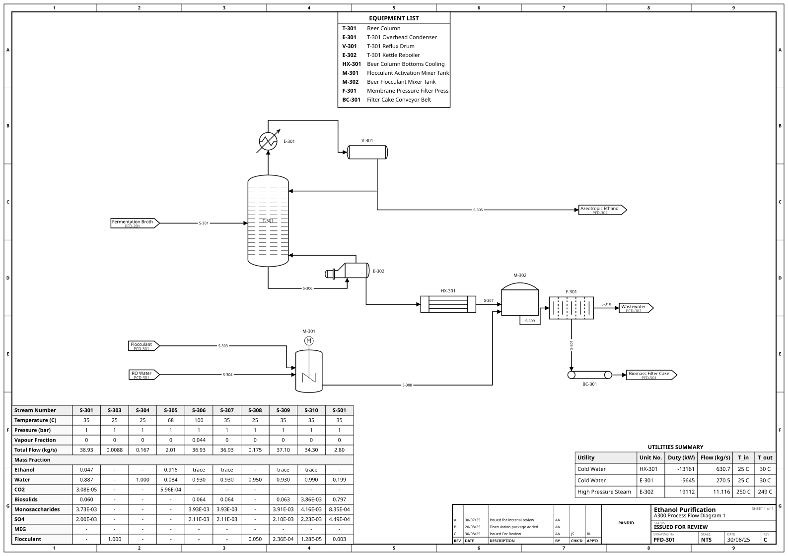

## 10 · Ethanol purification P&ID

A3 ethanol P&ID with valve stations, line numbers, control loops, and interlocks.

[`10_ethanol_pid.py`](../../examples/10_ethanol_pid.py) · [SVG](10_ethanol_pid.svg) · [draw.io](../../drawio-samples/10_ethanol_pid.drawio)

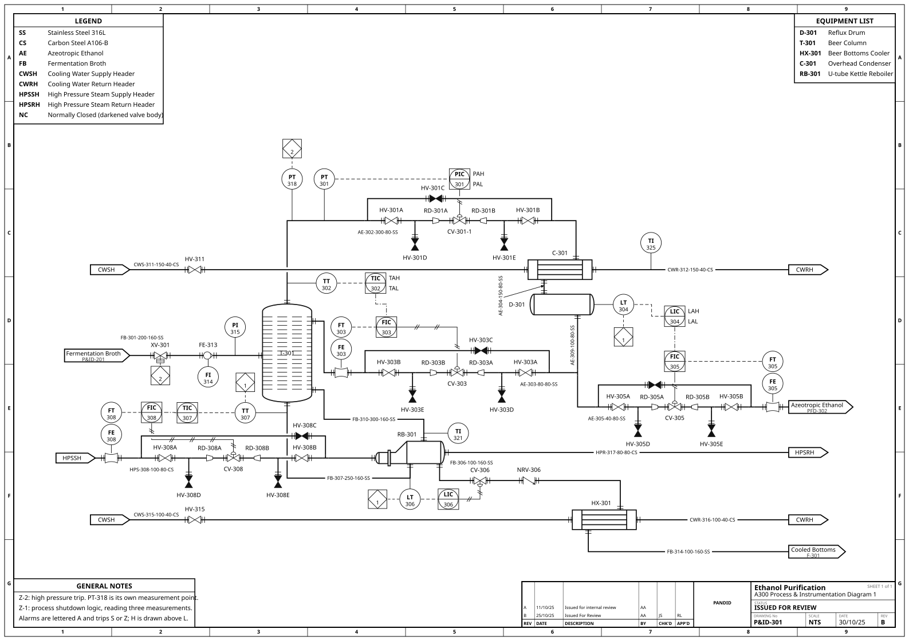

## 11 · Block flow diagram

Block flow diagram with labelled plant sections and connections on several faces.

[`11_block_flow_diagram.py`](../../examples/11_block_flow_diagram.py) · [SVG](11_block_flow_diagram.svg)

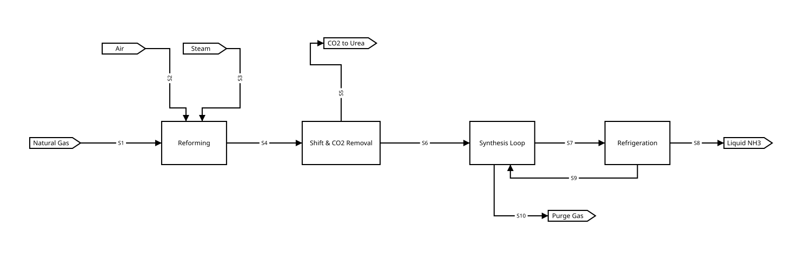

## 12 · Mineral concentrate dewatering

Solids-handling PFD with thickening, filtration, drying, classification, and gas cleaning.

[`12_mineral_dewatering.py`](../../examples/12_mineral_dewatering.py) · [SVG](12_mineral_dewatering.svg)

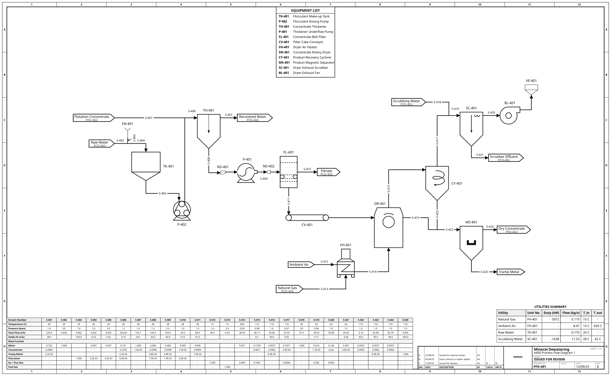

## 13 · Tank farm and road loading

Tank farm and loading rack with vapour handling, pipe hardware, and allocated loop numbers.

[`13_tank_farm.py`](../../examples/13_tank_farm.py) · [SVG](13_tank_farm.svg)

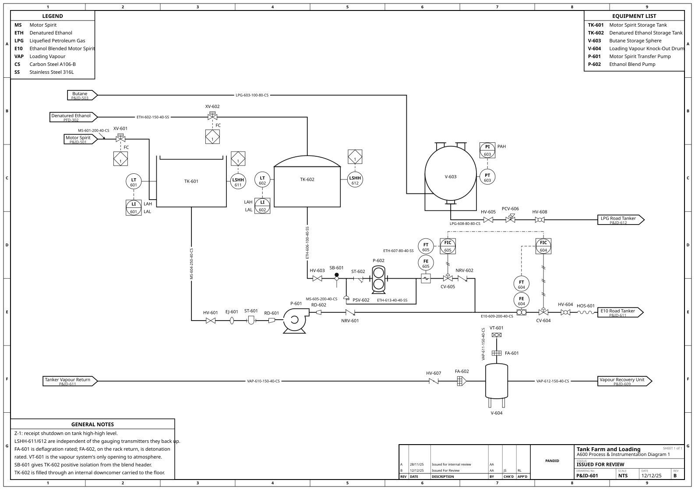

## 14 · Condensing turbine and vacuum system

Automatically placed condensing turbine and vacuum system with instrumentation.

[`14_condensing_turbine.py`](../../examples/14_condensing_turbine.py) · [SVG](14_condensing_turbine.svg)

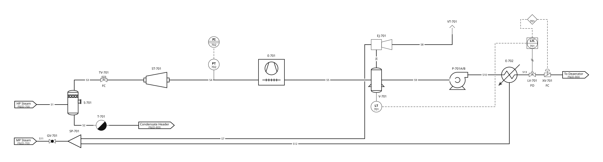

## 15 · Demineralised water plant

Automatically placed demineralised-water train with ion exchange and air stripping.

[`15_demineralised_water.py`](../../examples/15_demineralised_water.py) · [SVG](15_demineralised_water.svg)

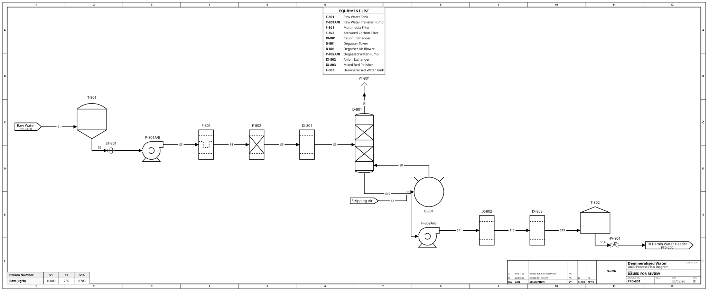

## 16 · Stirred reactor train

Jacketed stirred reactor with cooling control, alarms, and a safety trip.

[`16_stirred_reactor_train.py`](../../examples/16_stirred_reactor_train.py) · [SVG](16_stirred_reactor_train.svg)

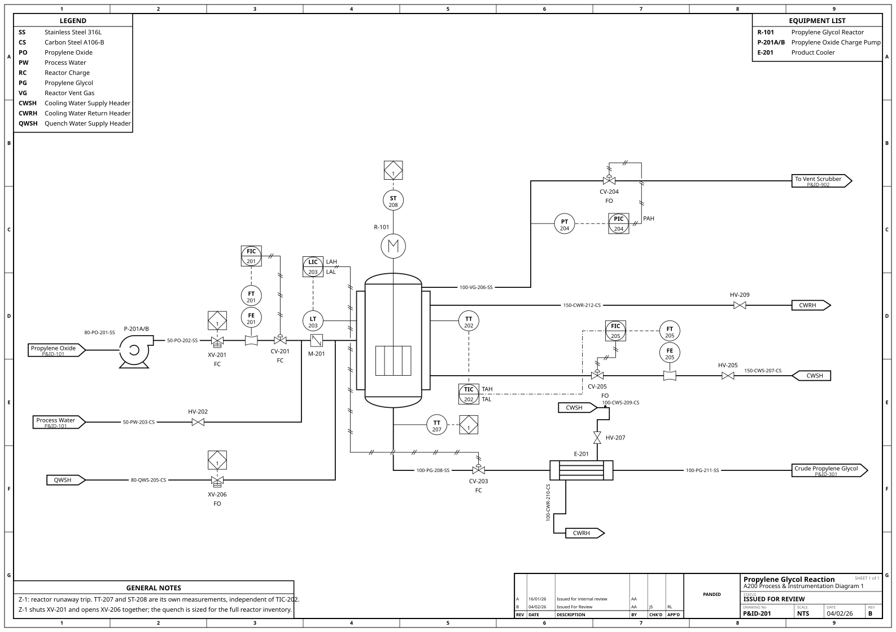

## 17 · Fixed-bed reactor with recycle

Packed-bed methanol-synthesis loop with purge and recycle.

[`17_fixed_bed_recycle.py`](../../examples/17_fixed_bed_recycle.py) · [SVG](17_fixed_bed_recycle.svg)

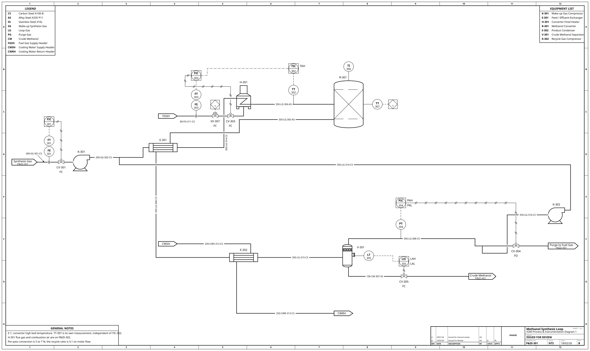

## 18 · Absorber and stripper

Absorber and regenerator with lean/rich exchange and separate column duties.

[`18_absorber_stripper.py`](../../examples/18_absorber_stripper.py) · [SVG](18_absorber_stripper.svg)

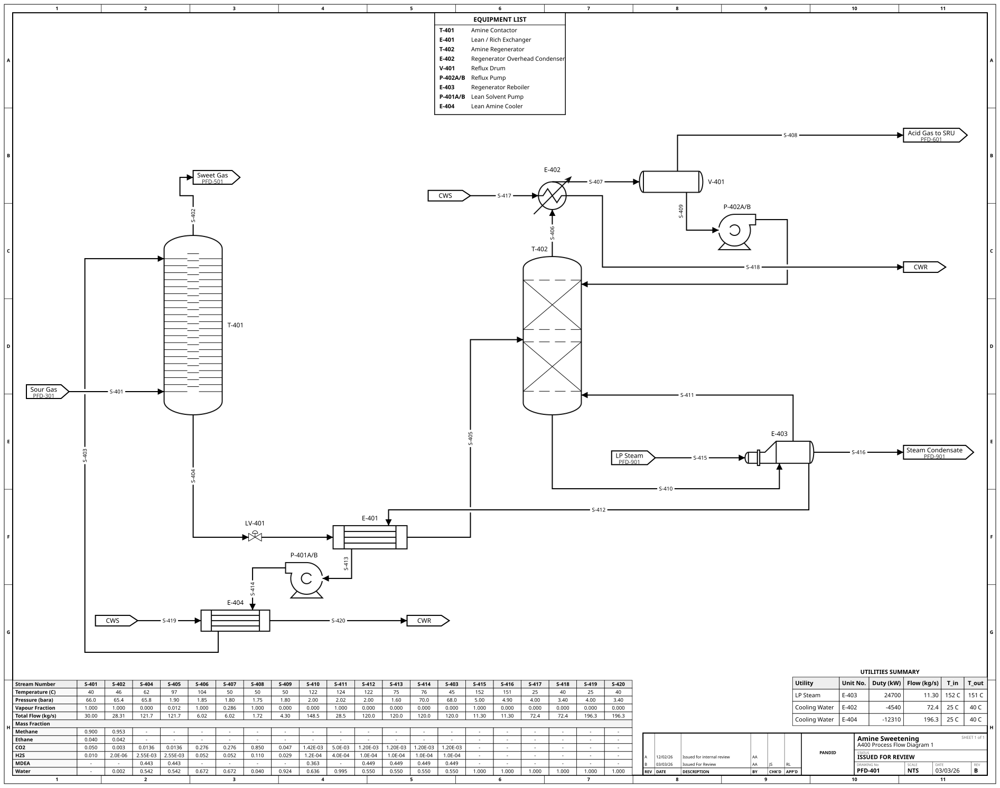

## 19 · Molecular sieve dryer

Two molecular-sieve beds with switching valves and repeated control logic.

[`19_molecular_sieve_dryer.py`](../../examples/19_molecular_sieve_dryer.py) · [SVG](19_molecular_sieve_dryer.svg)

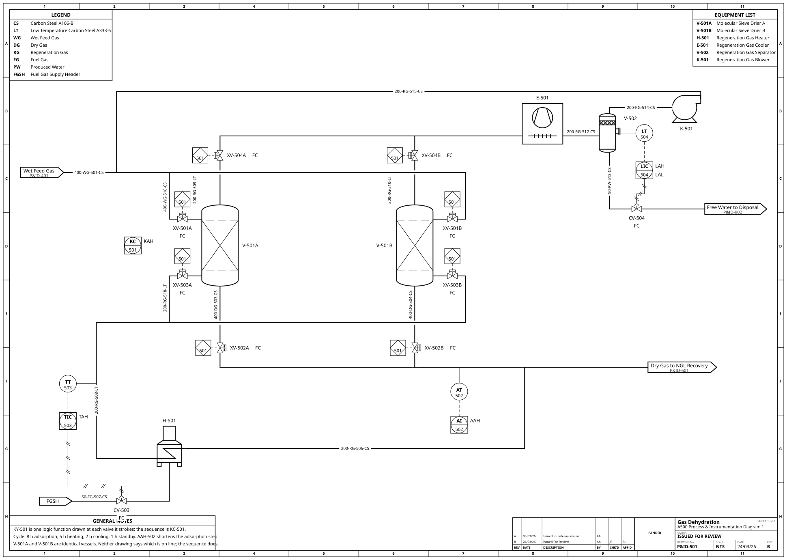

## 20 · Alumina refinery

Bayer-process PFDs from crushing to calcination on three sheets, joined by off-page
connectors that name each other's drawing. One script builds and renders all three.

[`20_alumina_refinery.py`](../../examples/20_alumina_refinery.py) · SVG: [sheet 1](20_alumina_refinery_1.svg), [sheet 2](20_alumina_refinery_2.svg), [sheet 3](20_alumina_refinery_3.svg)

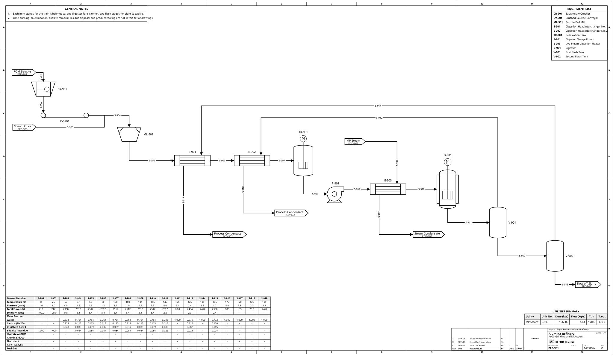

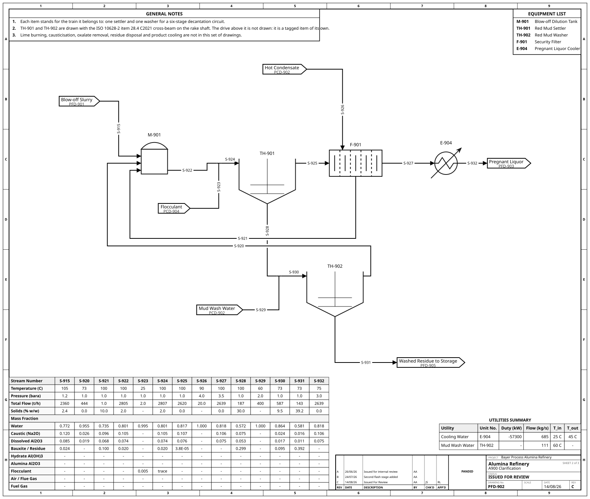

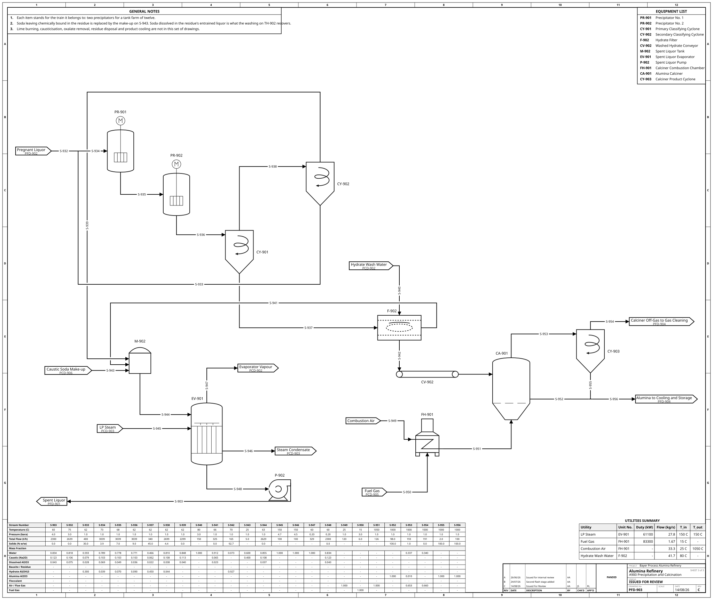
